# 🎣 Catch the Trash — PROJECT 1 PCV

---

## 📖 Daftar Isi

1. [Deskripsi Singkat](#-deskripsi-singkat)
2. [Fitur Utama](#-fitur-utama)
3. [Cara Main](#-cara-main)
4. [Cara Menjalankan](#cara-menjalankan)
5. [Struktur Project](#-struktur-project)
6. [Penjelasan Pembuatan](#-penjelasan-pembuatan)
7. [Troubleshooting](#-troubleshooting)


---

## 🌊 Deskripsi Singkat

**Catch the Trash** adalah game 2D sederhana yang menggunakan **webcam** sebagai controller. Pemain menggerakkan tangan di depan kamera, dan gerakan tersebut diterjemahkan menjadi pergerakan **kail pancing** di layar.


**Pakai:**
- Python 3
- OpenCV (Computer Vision)
- NumPy
- Teknik **Chroma Key** untuk rendering asset
- **HSV Color Detection** untuk deteksi tangan


---

##  Fitur Utama

| Fitur | Deskripsi |
|-------|-----------|
|  **Hand Tracking** | Kontrol kail dengan gerakan tangan via webcam |
| **Ikan** | 3 jenis ikan (kecil, sedang, besar) bergerak dari kiri ke kanan |
| **Sampah** | 2 jenis kaleng muncul di posisi acak sebagai target |
| **Score System** | Setiap sampah yang ditangkap = +10 poin |
| **Lives System** | 3 nyawa, berkurang saat kena ikan |
| **State Machine** | 3 state: START, PLAY, GAMEOVER |
| **Chroma Key** | Asset dengan background putih di-render transparan |
| **PIP Debug** | Tampilan mask tangan di pojok kiri atas |
| **Restart Instan** | Tekan R untuk main ulang |
| **Resizable Window** | Ukuran window bisa diubah, semua elemen menyesuaikan |

---

## 🎮 Cara Main

### Tujuan
Kumpulkan **skor sebanyak mungkin** dengan menangkap sampah, sambil **menghindari ikan**. Setiap 3 kali kena ikan = game over.

### Kontrol

| Aksi | Kontrol |
|------|---------|
| Gerakkan kail | Tangan di depan webcam |
| Mulai game | `SPACE` |
| Restart | `R` (di layar GAME OVER) |
| Keluar | `Q` |

### Aturan

| Kejadian | Efek |
|----------|------|
| Kail + Sampah (kaleng) | **+10 poin** |
| Kail + Ikan | **-1 nyawa** |
| Nyawa = 0 | **GAME OVER** |


---

## Cara Menjalankan

### 1. Prasyarat

- **Python 3.8+** — [Download](https://www.python.org/downloads/)
- **Webcam** — internal atau eksternal
- **OS:** Windows / macOS / Linux

### 2. Install Dependencies

```bash
pip install opencv-python numpy
```

**Verifikasi instalasi:**
```bash
python -c "import cv2; print(cv2.__version__)"
```

### 3. Siapkan Folder Asset
clone git

### 4. Jalankan Game

```bash
.\catchtrash.py
```

---

## 📁 Struktur Project

```
catchtrash/
│
├── catchtrash.py          
├── README.md     
├── img/         
│
└── assets/                
    ├── bg_underwater.jpg   
    ├── boat.jpg           
    ├── hook.jpg           
    ├── hati.jpg           
    ├── fish_small.jpg     
    ├── fish_medium.jpg    
    ├── fish_big.jpg       
    ├── kaleng1.png        
    └── kaleng2.jpg        
```

---

##  Penjelasan Pembuatan


### 1. Setup Camera

Buka webcam dan siapkan window yang bisa di-resize.

```python
cap = cv2.VideoCapture(0)
cap.set(cv2.CAP_PROP_FRAME_WIDTH, 640)
cap.set(cv2.CAP_PROP_FRAME_HEIGHT, 480)

cv2.namedWindow("Catch the Trash", cv2.WINDOW_NORMAL)
cv2.resizeWindow("Catch the Trash", 800, 600)
```


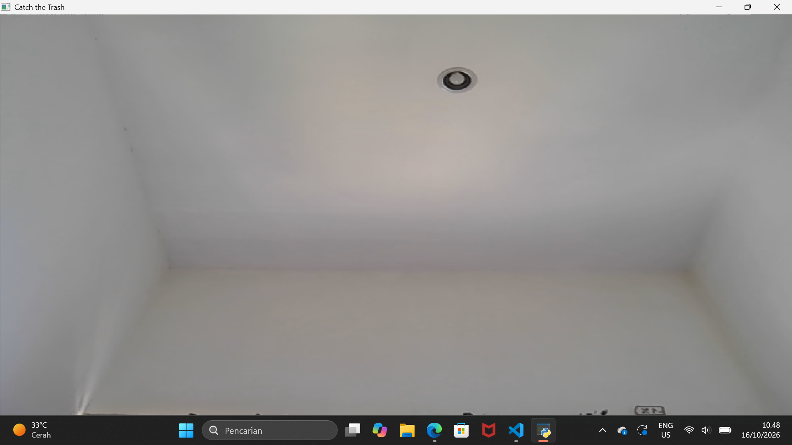 feed webcam live dengan mirror.

**Penjelasan:**
- `VideoCapture(0)` → webcam default
- `CAP_PROP_FRAME_WIDTH/HEIGHT` → resolusi **capture** (640×480)
- `WINDOW_NORMAL` → window bisa di-resize manual
- `resizeWindow` → ukuran awal window

**Frame mirror:** setiap frame di-flip supaya gerakan tangan terasa seperti cermin.
```python
frame = cv2.flip(frame, 1)
```

**Ukuran window diambil dinamis** setiap loop supaya semua elemen menyesuaikan:
```python
rect = cv2.getWindowImageRect("Catch the Trash")
win_w, win_h = rect[2], rect[3]
```

---

### 2. Background

Background bawah laut di-render setiap frame, di-resize sesuai ukuran window.

```python
bg = load_asset("bg_underwater.jpg")
...
display = cv2.resize(bg, (win_w, win_h)).copy()
```
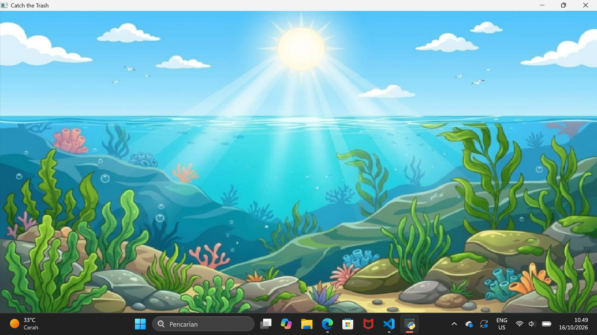 background di-resize saat window diubah ukurannya.

**Penjelasan:**
- `.copy()` → **wajib** supaya tidak memodifikasi `bg` asli
- Tanpa `.copy()`, resize berikutnya akan menimpa `bg` dengan ukuran berbeda

---

### 3. Chroma Key

**Masalah:** Asset punya background putih → kalau ditempel langsung, akan muncul kotak putih.

**Solusi:** Deteksi piksel putih, lalu skip saat compositing.

```python
def chroma_key_overlay(frame, asset, x, y, frame_w, frame_h):
    # ... clipping ...
    white_mask = cv2.inRange(asset_roi, 
                             np.array([240,240,240]), 
                             np.array([255,255,255]))
    non_white = cv2.bitwise_not(white_mask)
    
    for c in range(3):
        frame_roi[:, :, c] = np.where(non_white > 0,
                                       asset_roi[:, :, c],
                                       frame_roi[:, :, c])
```
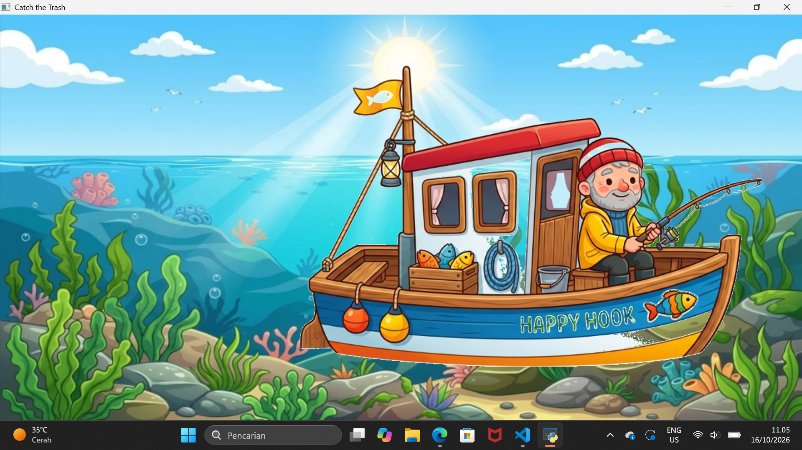 asset muncul tanpa kotak putih.

**Konsep:**
1. **Clipping** → potong area yang keluar layar
2. **Offset `src_x1, src_y1`** → koordinat bagian asset yang digambar
3. **`inRange`** → deteksi piksel putih (background asset)
4. **`bitwise_not`** → invert mask → dapat piksel objek
5. **`np.where`** → tempel piksel objek saja

**Kenapa threshold 240, bukan 255?**
Karena JPG punya **kompresi lossy** — putih murni bisa jadi 248, 250, dst.

---

### 4. Load Assets

Semua asset dimuat sebagai BGR 3 kanal.

```python
def load_asset(filename):
    path = ASSETS_DIR + "/" + filename
    img = cv2.imread(path, cv2.IMREAD_COLOR)
    if img is None:
        raise FileNotFoundError(f"Asset tidak ditemukan: {path}")
    return img

bg = load_asset("bg_underwater.jpg")
boat = load_asset("boat.jpg")
hook = load_asset("hook.jpg")
hati_img = load_asset("hati.jpg")
fish_small = load_asset("fish_small.jpg")
fish_medium = load_asset("fish_medium.jpg")
fish_big = load_asset("fish_big.jpg")
kaleng1 = load_asset("kaleng1.png")
kaleng2 = load_asset("kaleng2.jpg")
```
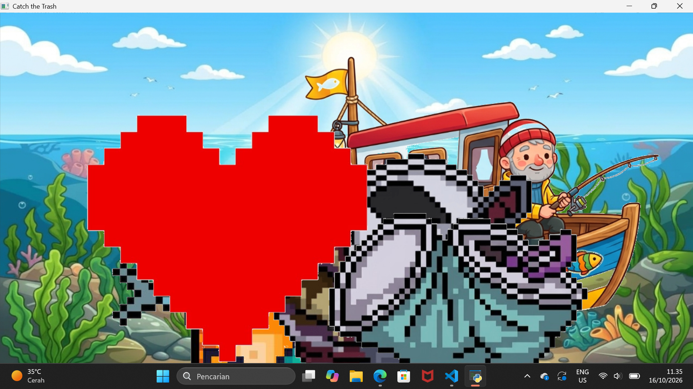 semua asset di-load tanpa error.

**Kenapa `IMREAD_COLOR` bukan `IMREAD_UNCHANGED`?**
Karena kita pakai **chroma key** (hapus putih manual), bukan alpha channel. Jadi semua asset dipaksa jadi 3 kanal BGR.

**List untuk random:**
```python
fish_assets = [fish_small, fish_medium, fish_big]
trash_assets = [kaleng1, kaleng2]
```

---

### 5. Resize

Semua asset di-resize supaya proporsional.

```python
# Hook → lebar 40px
hook = cv2.resize(hook, (40, int(hook.shape[0] * (40 / hook.shape[1]))))

# Boat → 40% dari ukuran asli
boat = cv2.resize(boat, (int(boat.shape[1] * 0.4), int(boat.shape[0] * 0.4)))

# Ikan → lebar 90 / 60 / 90
fish_small = cv2.resize(fish_small, (90, ...))
fish_medium = cv2.resize(fish_medium, (60, ...))
fish_big = cv2.resize(fish_big, (90, ...))
```
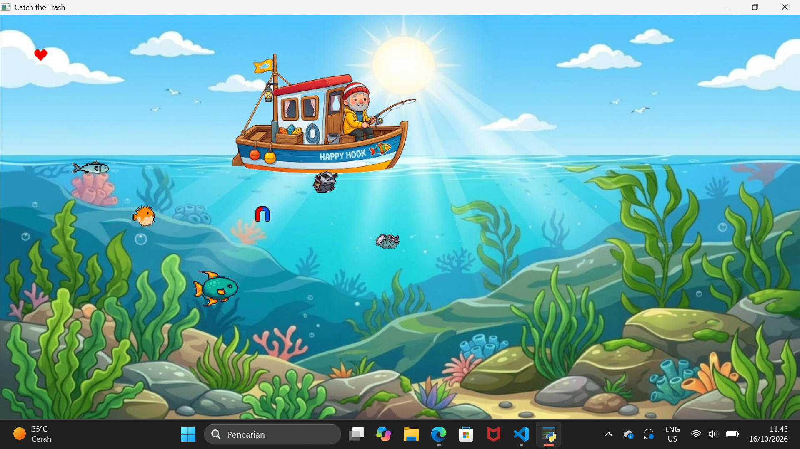 perbandingan ukuran sebelum & sesudah resize.

**Rumus aspect ratio:**
```
rasio = target_w / original_w
new_h = original_h × rasio
```

**Radius collision** harus proporsional dengan ukuran:
```python
fish_radii = [45, 30, 50]  # small, medium, big
```

---

### 6. HSV (Deteksi Warna Kulit)

Konversi frame dari **BGR → HSV**, lalu threshold warna kulit.

```python
HSV_LOWER = np.array([0, 50, 50])
HSV_UPPER = np.array([20, 255, 255])

hsv = cv2.cvtColor(frame, cv2.COLOR_BGR2HSV)
mask = cv2.inRange(hsv, HSV_LOWER, HSV_UPPER)
```
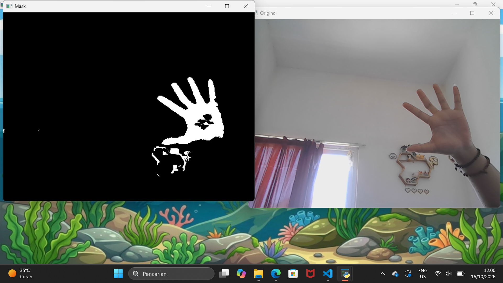 tuning HSV dengan trackbar, tangan berubah jadi blob putih.

**Kenapa HSV, bukan BGR?**
- BGR sangat sensitif terhadap cahaya
- HSV memisahkan **warna (H)** dari **kecerahan (V)** — lebih stabil

**Range warna kulit (Asia/Indonesia):**
- H = 0-20 (merah-oranye)
- S = 50-255 (cukup pekat)
- V = 50-255 (cukup terang)

---

### 7. Morfologi

Mask dari `inRange` masih **kotor** — ada noise bintik-bintik dan lubang.

```python
MORPH_KERNEL = cv2.getStructuringElement(cv2.MORPH_ELLIPSE, (5, 5))

mask = cv2.morphologyEx(mask, cv2.MORPH_OPEN, MORPH_KERNEL)
mask = cv2.morphologyEx(mask, cv2.MORPH_CLOSE, MORPH_KERNEL)
```
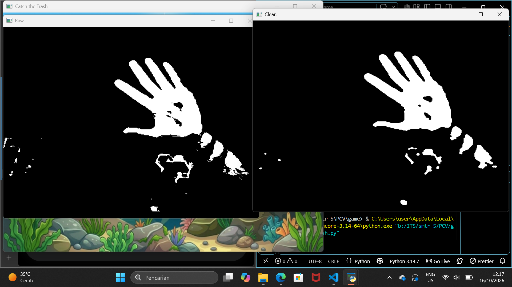 perbandingan mask mentah vs bersih.

**Operasi morfologi:**

| Operasi | Fungsi | Efek |
|---------|--------|------|
| **OPEN** | Erode → Dilate | Hapus noise kecil |
| **CLOSE** | Dilate → Erode | Tutup lubang kecil |

**Kernel ellipse** (bukan rect) → hasil lebih natural untuk objek organik seperti tangan.

---

### 8. Centroid (Pusat Tangan)

Cari **titik pusat massa** dari kontur terbesar.

```python
def detect_hand(frame):
    # ... HSV + morfologi ...
    contours, _ = cv2.findContours(mask, cv2.RETR_EXTERNAL, 
                                    cv2.CHAIN_APPROX_SIMPLE)
    if contours:
        largest = max(contours, key=cv2.contourArea)
        M = cv2.moments(largest)
        if M["m00"] > 0:
            cx = int(M["m10"] / M["m00"])
            cy = int(M["m01"] / M["m00"])
            return cx, cy, mask
    return None, None, mask
```


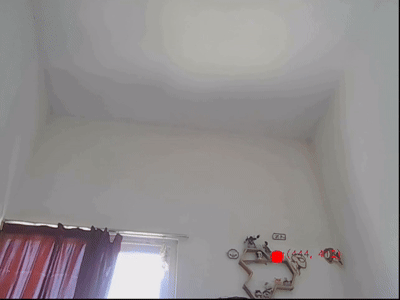 
lingkaran merah bergerak mengikuti tangan.

**Rumus centroid:**
```
cx = M["m10"] / M["m00"]   # pusat massa X
cy = M["m01"] / M["m00"]   # pusat massa Y
```

**Guard `M["m00"] > 0`:** hindari division by zero kalau kontur degenerate.

---

### 9. PIP (Picture-in-Picture)

Debug visual: tampilkan mask tangan kecil di pojok kiri atas.

```python
pip_w, pip_h = 160, 120
mask_resized = cv2.resize(hand_mask, (pip_w, pip_h))
mask_3ch = cv2.cvtColor(mask_resized, cv2.COLOR_GRAY2BGR)
cv2.rectangle(display, (10, 10), (10 + pip_w, 10 + pip_h), 
              (255, 255, 255), 2)
display[10:10+pip_h, 10:10+pip_w] = mask_3ch
```
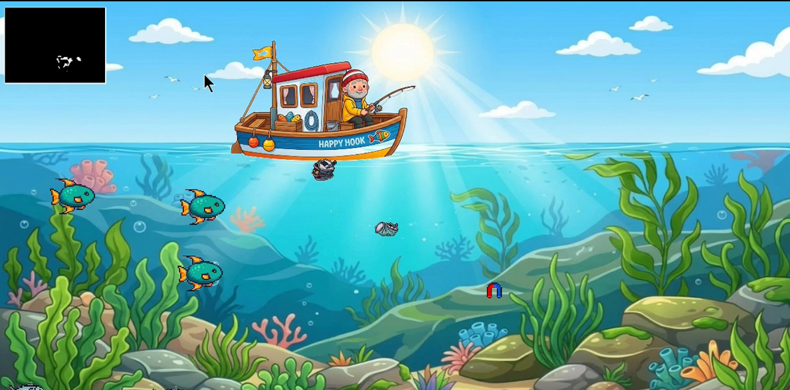 PIP update real-time mengikuti tangan.

---

### 10. Spawn Ikan

Ikan di-spawn secara periodik dan bergerak dari kiri ke kanan.

```python
spawn_timer += 1

if spawn_timer % 60 == 0:
    fish_type = random.choice([0, 1, 2])
    fishes.append({
        'asset': fish_assets[fish_type],
        'x': -50,                    # mulai dari luar kiri
        'y': random.randint(250, win_h - 50),
        'speed': random.uniform(1, 3),
        'radius': fish_radii[fish_type],
        'type': fish_type
    })
```
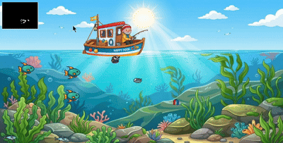 

ikan muncul dari kiri, bergerak ke kanan, hilang di kanan.

**Penjelasan:**
- `spawn_timer % 60` → setiap 60 frame sekali
- `x = -50` → mulai dari luar layar kiri
- `y = randint(250, win_h - 50)` → area bawah (hindari perahu)

---

### 11. Spawn Sampah

Sampah muncul di posisi acak dan **diam**.

```python
if spawn_timer % 120 == 0 and len(trash_items) < 4:
    trash_items.append({
        'asset': random.choice(trash_assets),
        'x': random.randint(100, win_w - 50),
        'y': random.randint(300, win_h - 50),
        'radius': 20
    })
```
 

sampah muncul di posisi acak, max 4 di layar.

**Berbeda dengan ikan:**
- Sampah **tidak bergerak** (tidak ada `x += speed`)
- Sampah **hilang** saat ditangkap (di-handle di collision)

---

### 12. Collision Sampah (Score)

Cek jarak hook dengan tiap sampah. Kalau **< radius sampah + radius hook**, tabrakan.

```python
surviving_trash = []
for t in trash_items:
    dist = math.sqrt((hook_x - t['x'])**2 + (hook_y - t['y'])**2)
    if dist < t['radius'] + 15:
        score += 10
    else:
        surviving_trash.append(t)
trash_items = surviving_trash
```
 

hook menyentuh sampah, sampah hilang, score +10.

---
### 13. Collision Ikan (Lives)

Sama seperti sampah, tapi:
- Ikan **tidak hilang** saat nabrak
- **Nyawa** berkurang
- Pakai flag `hit_fish` supaya **hanya 1 nyawa hilang per frame**

```python
surviving_fishes = []
hit_fish = False

for f in fishes:
    dist = math.sqrt((hook_x - f['x'])**2 + (hook_y - f['y'])**2)
    if dist < f['radius'] + 15 and not hit_fish:
        lives -= 1
        hit_fish = True
        if lives <= 0:
            state = STATE_GAMEOVER
    else:
        surviving_fishes.append(f)
fishes = surviving_fishes
```
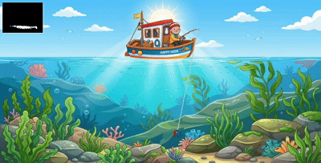 

hook nabrak ikan, nyawa berkurang 1 (tidak langsung habis).

**Kenapa flag `hit_fish` penting?**

Tanpa flag:
```
Ikan A nabrak → lives 3→2
Ikan B nabrak → lives 2→1
Ikan C nabrak → lives 1→0 → GAMEOVER dalam 1 frame!
```

Dengan flag: hanya 1 nyawa hilang per frame.

---

### 14. State START

Layar pembuka — hanya tampilkan teks, tidak ada gameplay.

```python
if state == STATE_START:
    cv2.putText(display, "CATCH THE TRASH", 
                (win_w // 2 - 290, win_h // 2 - 30),
                cv2.FONT_HERSHEY_SIMPLEX, 2, (0, 165, 255), 3)
    cv2.putText(display, "PRESS SPACE TO START",
                (win_w // 2 - 190, win_h // 2 + 70),
                cv2.FONT_HERSHEY_SIMPLEX, 1, (255, 255, 255), 2)
```
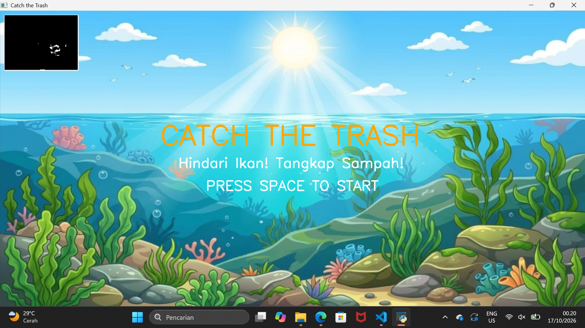 
layar pembuka, tekan SPACE untuk mulai.

**Transisi ke PLAY:** tekan SPACE.

---

### 15. State GAMEPLAY

Ini **inti permainan** — semua logika dijalankan:

1. Mapping tangan → hook
2. Spawn timer
3. Spawn ikan & sampah
4. Update posisi ikan
5. Collision sampah → score
6. Collision ikan → lives
7. Render semua objek (urutan penting!)
8. Render tali pancing
9. Render hook
10. Render skor & hati

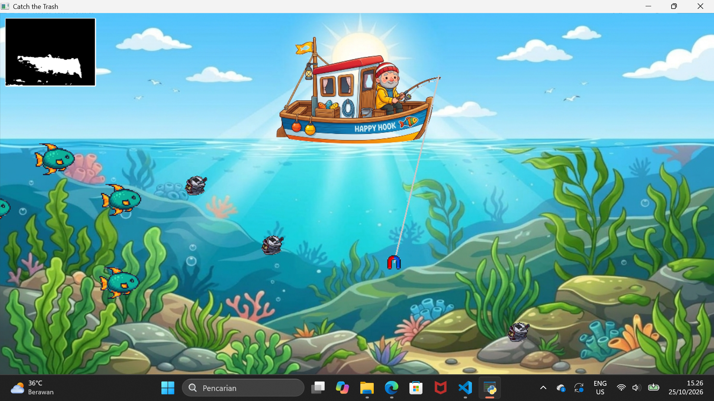 
full gameplay: tangan kontrol kail, tangkap sampah, hindari ikan.

**Mapping tangan:**
```python
if hand_x is not None and hand_y is not None:
    cam_w, cam_h = frame.shape[1], frame.shape[0]
    hook_x = int(hand_x * (win_w / cam_w))
    hook_y = int(hand_y * (win_h / cam_h))
```

**Urutan render (PENTING!):**
```
1. Background      (paling bawah)
2. Sampah
3. Ikan
4. Perahu
5. Tali pancing
6. Hook
7. Skor
8. Hati / UI       (paling atas)
```

---

### 16. State GAMEOVER

Ditampilkan saat `lives <= 0`.

```python
elif state == STATE_GAMEOVER:
    cv2.putText(display, "GAME OVER",
                (win_w // 2 - 225, win_h // 2 - 40),
                cv2.FONT_HERSHEY_SIMPLEX, 2.5, (0, 0, 255), 3)
    cv2.putText(display, f"FINAL SCORE: {score}",
                (win_w // 2 - 200, win_h // 2 + 20),
                cv2.FONT_HERSHEY_SIMPLEX, 1.5, (0, 255, 255), 2)
    cv2.putText(display, "PRESS R TO RESTART",
                (win_w // 2 - 170, win_h // 2 + 70),
                cv2.FONT_HERSHEY_SIMPLEX, 1, (255, 255, 255), 2)
```
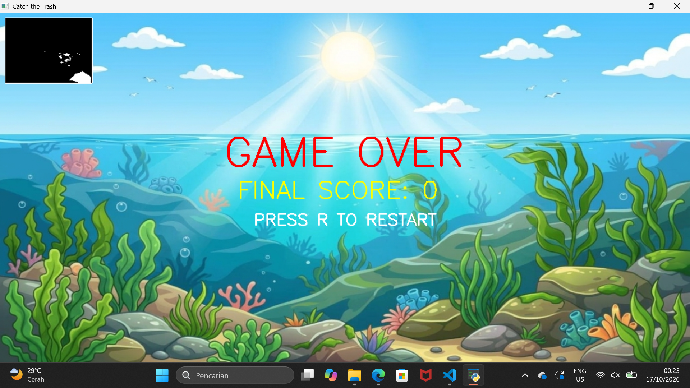 
transisi dari PLAY ke GAMEOVER saat nyawa habis.

**Reset saat restart:**
```python
elif key == ord('r'):
    if state == STATE_GAMEOVER:
        state = STATE_START
        score = 0
        lives = 3
        fishes = []
        trash_items = []
        spawn_timer = 0
```

---

### 17. Teks Score & Hati

**Score** ditampilkan di pojok kanan atas:

```python
cv2.putText(display, f"SCORE: {score}", 
            (win_w - 200, 40), 
            cv2.FONT_HERSHEY_SIMPLEX, 0.8, (0, 0, 0), 2)
```

**Hati** sebagai icon nyawa:

```python
for i in range(lives):
    hati_x = win_w - 200 + (i * 40)
    hati_y = 50
    chroma_key_overlay(display, hati_ui, hati_x, hati_y, win_w, win_h)
```
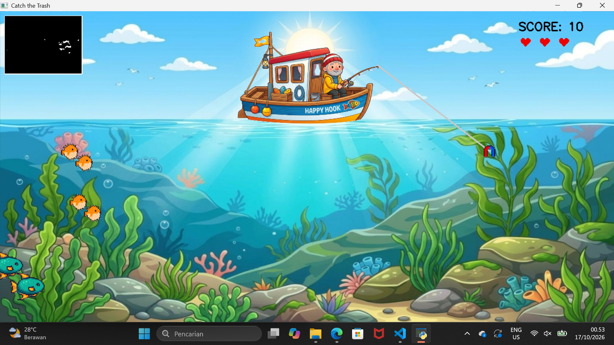 
score bertambah saat tangkap sampah, hati berkurang saat kena ikan.

**Penjelasan:**
- `range(lives)` → kalau `lives = 3`, render 3 hati
- `i * 40` → jarak antar hati 40px
- `hati_y = 50` → di bawah teks skor

---
## GAMEPLAY
<video src="img/gameplay.mp4" width="100%" controls></video>
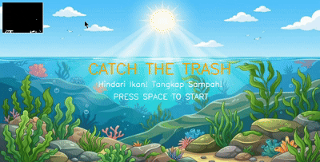

